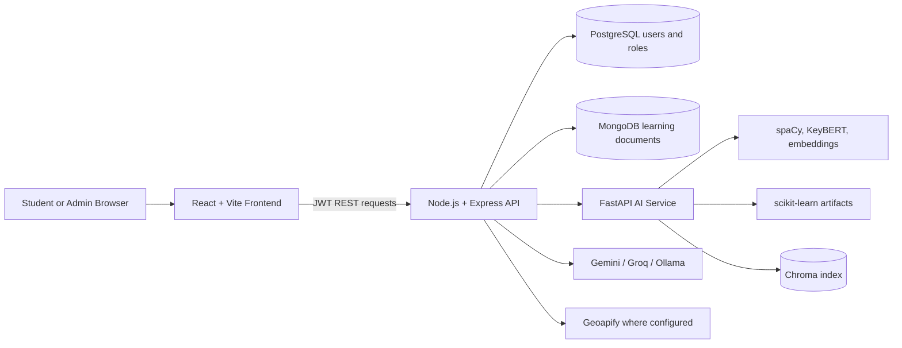
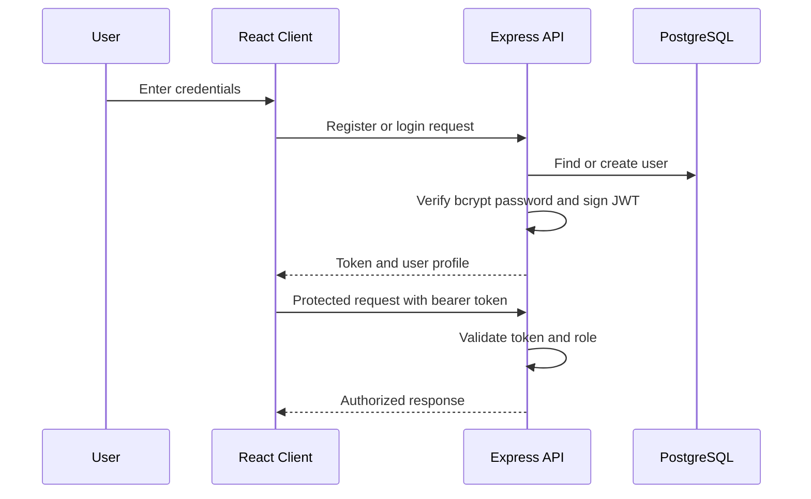
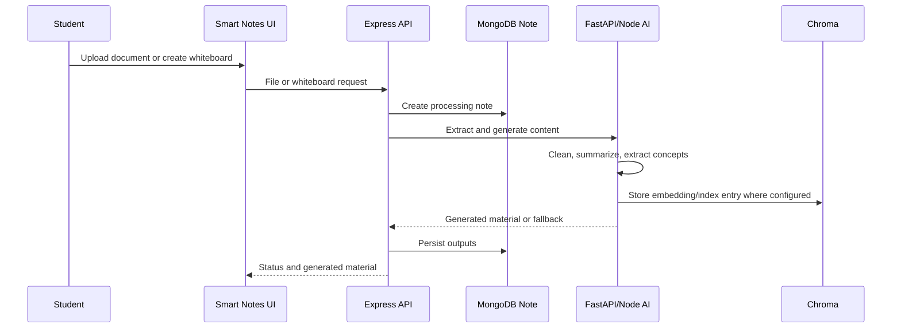
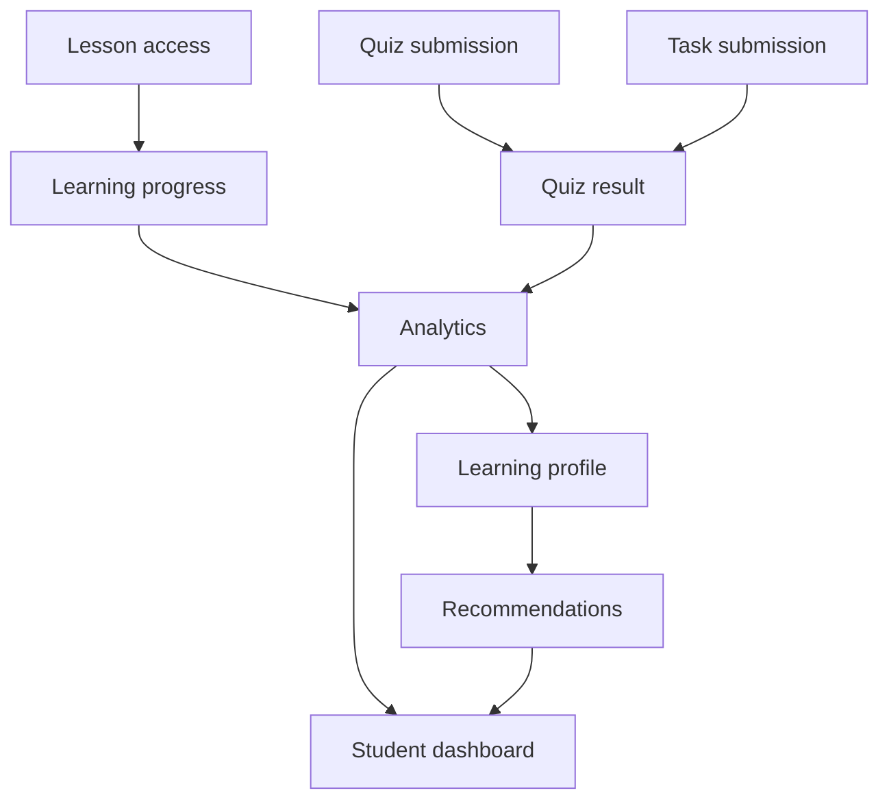
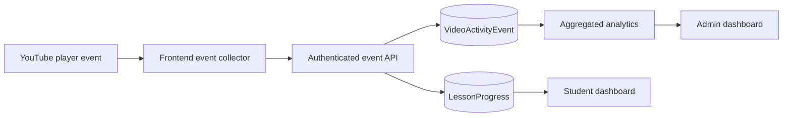
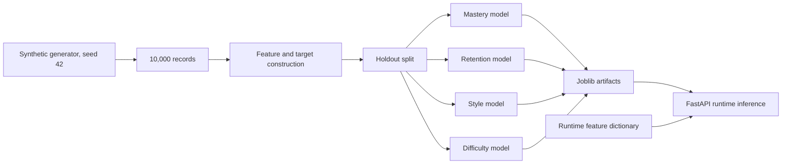
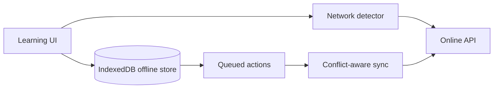

# FirstStep Digital Education Platform

## Complete Project Documentation Manuscript and 60-Page Preparation Guide

> **Project slogan:** Learn Smarter, Think Better.  
> **Document status:** Source-grounded manuscript template  
> **Prepared from:** FirstStep repository implementation, configuration, tests, and existing project audits  
> **Recommended final format:** A4, Times New Roman 12 pt, 1.15 or 1.5 line spacing, justified body text, 1-inch margins

---

## How to use this document

This file is written so it can be converted into a project report of approximately 50-60 pages after adding the actual screenshots, diagrams, title pages, certificates, and appendices. The page numbers below are planning targets, not fixed printed page numbers. Recalculate them after inserting images.

Use the labels below while preparing the final report:

- **[VERIFIED]** - directly supported by the repository implementation or an executed validation.
- **[PARTIAL]** - implemented in one or more layers but incomplete, fallback-based, or not fully integrated.
- **[PROPOSED]** - recommended future work and must not be reported as completed.
- **[SCREENSHOT REQUIRED]** - capture the named screen from a running local or deployed application.
- **[DIAGRAM REQUIRED]** - render the Mermaid diagram or redraw it using draw.io, Visio, or another diagram tool.

Do not claim measured learning improvement, validated personalization, true offline learning, or production-ready security unless a separate experiment proves it. Existing evidence supports an implemented educational platform and an evidence-aware AI/ML integration, not a controlled learning-outcome study.

---

# Front Matter

## Title Page

**FIRSTSTEP DIGITAL EDUCATION PLATFORM**  
**An AI-Assisted Modular Learning and Learning Analytics System**

Project documentation submitted in partial fulfillment of the requirements for the award of:

**[Degree / Diploma Name]**

Submitted by:

**[Student Name]**  
**[Register Number]**

Under the guidance of:

**[Guide Name]**  
**[Department / Institution]**

**[Institution Name]**  
**[Academic Year]**

**Formatting note:** Keep the title page separate and do not number it. Add the institution logo and department logo only if permitted.

## Certificate

Insert the institution's approved certificate format here. Do not invent signatures, dates, or approval numbers.

## Declaration

Insert the institution's approved declaration format here. The student should confirm that the implementation and report are their own work and that referenced libraries, datasets, and external services are acknowledged.

## Acknowledgement

Suggested text:

> I express my sincere gratitude to my project guide, department, institution, classmates, and family for their guidance and support during the design, implementation, testing, and documentation of FirstStep. I also acknowledge the open-source communities and documentation authors whose tools and libraries made this project possible.

## Abstract

FirstStep is a modular digital education platform designed to bring structured learning, document-based study support, learner assessment, progress tracking, and administrative monitoring into one application. The implementation combines a React and Vite frontend, a Node.js and Express backend, PostgreSQL-based identity management, MongoDB-based educational data storage, and a Python FastAPI service for artificial intelligence and machine-learning workflows. The platform includes Smart Notes, Learning Academy, Learning Twin, Learning Assessment, Programming Learning, Knowledge Forest, Thinking Lab, student dashboards, and administrator dashboards.

The Smart Notes workflow accepts documents and whiteboard content, extracts and processes text, generates summaries and study material, stores note metadata, and supports semantic indexing through Chroma where configured. Programming Learning provides lessons, quizzes, notes, flashcards, recommendations, and YouTube playback telemetry. Authentication uses password hashing, JWT access tokens, and student/admin authorization paths. Four scikit-learn artifacts are trained from a 10,000-record synthetic dataset for mastery, retention, learning style, and difficulty estimation. These model results are experimental synthetic-data results and are not evidence of real-world student outcomes.

The project demonstrates how educational content, learner activity, artificial intelligence, and analytics can be integrated into a single service-oriented platform. The principal contribution is the implementation of a broad, source-grounded learning architecture with explicit separation between persistent application behavior, external AI generation, pretrained NLP components, heuristic fallbacks, and experimental machine-learning inference. Future work should focus on real consented learner data, educational validation, stronger integration testing, secure deployment configuration, and a fully implemented offline synchronization mode.

**Keywords:** artificial intelligence in education, personalized learning, learning analytics, document processing, learner profile, educational technology, video telemetry, machine learning.

## Table of Contents

Generate this automatically in Word or LibreOffice after applying heading styles. Do not type final page numbers manually.

## List of Figures

| Figure | Title | Planned page |
|---|---|---:|
| Figure 1 | FirstStep system architecture | 12 |
| Figure 2 | Authentication and authorization flow | 14 |
| Figure 3 | Smart Notes processing workflow | 17 |
| Figure 4 | Learning and assessment data flow | 20 |
| Figure 5 | Programming video telemetry flow | 22 |
| Figure 6 | Machine-learning training and inference pipeline | 25 |
| Figure 7 | Student dashboard navigation map | 30 |
| Figure 8 | Admin analytics flow | 34 |
| Figure 9 | Entity relationship overview | 39 |
| Figure 10 | Deployment topology | 43 |
| Figure 11 | Testing and validation workflow | 49 |
| Figure 12 | Future offline synchronization architecture | 56 |

## List of Tables

| Table | Title | Planned page |
|---|---|---:|
| Table 1 | Abbreviations and symbols | 5 |
| Table 2 | Feature status and evidence boundary | 10 |
| Table 3 | Functional requirements | 27 |
| Table 4 | Non-functional requirements | 29 |
| Table 5 | Technology stack | 31 |
| Table 6 | Core data stores and responsibilities | 38 |
| Table 7 | Representative API surface | 41 |
| Table 8 | Test cases and expected results | 47 |
| Table 9 | Machine-learning artifacts and metrics | 51 |
| Table 10 | Limitations and mitigation plan | 54 |

## List of Screens

Capture these screens from the running application. Use one screenshot per numbered item, crop browser chrome where appropriate, and redact email addresses, tokens, student IDs, uploaded documents, and other personal data.

| Screen | Screenshot to capture | Planned page |
|---|---|---:|
| Screen 1 | Login page | 7 |
| Screen 2 | Registration page | 7 |
| Screen 3 | Student dashboard | 30 |
| Screen 4 | Smart Notes library | 32 |
| Screen 5 | Note detail and generated study material | 32 |
| Screen 6 | Whiteboard Studio | 33 |
| Screen 7 | Learning Academy | 35 |
| Screen 8 | Learning Assessment | 36 |
| Screen 9 | Learning Twin | 36 |
| Screen 10 | Programming Learning subject/lesson view | 37 |
| Screen 11 | Programming quiz and progress state | 37 |
| Screen 12 | Knowledge Forest | 38 |
| Screen 13 | Thinking Lab | 38 |
| Screen 14 | Admin dashboard | 44 |
| Screen 15 | Admin student detail | 45 |
| Screen 16 | Admin content/lesson management | 45 |
| Screen 17 | API health or deployment screen | 46 |
| Screen 18 | ML analysis chart | 52 |

## Symbols and Abbreviations

| Term | Meaning |
|---|---|
| AI | Artificial Intelligence |
| API | Application Programming Interface |
| CSS | Cascading Style Sheets |
| DFD | Data Flow Diagram |
| JWT | JSON Web Token |
| LLM | Large Language Model |
| ML | Machine Learning |
| NLP | Natural Language Processing |
| REST | Representational State Transfer |
| UI | User Interface |
| UX | User Experience |
| CRUD | Create, Read, Update, Delete |
| PDF | Portable Document Format |
| DOCX | Microsoft Word document format |
| RAG | Retrieval-Augmented Generation |
| SQL | Structured Query Language |
| NoSQL | Non-relational database |
| NER | Named Entity Recognition |
| CSV | Comma-Separated Values |
| HTTP | Hypertext Transfer Protocol |
| HTTPS | Hypertext Transfer Protocol Secure |
| CORS | Cross-Origin Resource Sharing |
| ORM/ODM | Object/Document Relational Mapping |
| MAE | Mean Absolute Error |
| R2 | Coefficient of determination |

---

# 1. Introduction

## 1.1 Background

Digital education systems commonly provide course content, examinations, and progress indicators as separate functions. Learners may still need to search for study material, organize notes, understand weak concepts, revise at the right time, and interpret their own progress. Teachers and administrators also need reliable records of student activity and curriculum content.

FirstStep addresses this problem through a modular learning companion. It combines structured lessons, AI-assisted document processing, assessments, learner profiles, visual concept structures, programming lessons, thinking exercises, and administration. The system is particularly motivated by the need for accessible learning support for students who may not have continuous access to expert tutoring.

## 1.2 Project Motivation

The project is motivated by five practical needs:

1. Provide a single entry point for multiple learning activities.
2. Convert learner-provided documents into organized study material.
3. Persist progress and assessment information for later review.
4. Provide learner-facing and administrator-facing analytics.
5. Establish an extensible architecture for future personalization and offline access.

## 1.3 Problem Statement

Students often use disconnected tools for lessons, notes, practice, revision, and progress tracking. These tools rarely share a learner profile or provide a coherent view of learning behavior. Administrators may also lack a consolidated view of student progress and content engagement.

The problem addressed by FirstStep is:

> How can a modular, secure, and extensible educational platform integrate content learning, document-based study support, assessment, learner activity, analytics, and AI-assisted features without presenting unvalidated predictions as confirmed learning outcomes?

## 1.4 Objectives

- Build a responsive web application for student and administrator workflows.
- Implement registration, login, JWT authentication, and role-based access.
- Provide structured learning modules and programming lessons.
- Allow users to upload or create notes and generate study material.
- Record assessments, lesson progress, and selected video activity.
- Provide learner profiles, recommendations, and dashboards.
- Provide administrator summaries, student detail views, content management, and activity monitoring.
- Integrate Python AI/ML pipelines while preserving local fallbacks where appropriate.
- Maintain a clear evidence boundary between implemented behavior and future research.

## 1.5 Scope

### Included

- React frontend with protected routes.
- Express REST API under the `/api` and `/api/v1` namespaces.
- PostgreSQL user and role persistence.
- MongoDB learning and application documents.
- FastAPI AI service and model artifacts.
- Smart Notes, Learning Academy, Learning Twin, Learning Assessment, Programming Learning, Knowledge Forest, and Thinking Lab.
- Student and admin dashboards.
- Automated contract and safety tests available in the repository.

### Outside the verified scope

- A controlled experiment proving learning gains.
- A psychometrically validated assessment.
- A production-grade offline synchronization system.
- A learned knowledge graph generated from all user notes.
- Guaranteed factual correctness of generated AI content.
- A claim that video playback proves attention or comprehension.

## 1.6 Contribution

FirstStep contributes an integrated architecture rather than a single novel algorithm. Its value lies in connecting learning workflows, document processing, data persistence, analytics, visualizations, and experimental AI/ML components while documenting the boundary between verified implementation and unsupported claims.

---

# 2. Literature Survey

## 2.1 Existing System

Existing educational platforms generally provide combinations of:

- Learning management systems for courses and assignments.
- Note-taking and document annotation tools.
- Video learning platforms with completion tracking.
- Intelligent tutoring systems.
- Learning analytics dashboards.
- Adaptive testing and recommendation engines.

These systems often specialize in one area. A course platform may not understand a learner's uploaded notes; a note-taking tool may not connect to quiz performance; a video platform may show watch percentage without relating it to concept mastery.

## 2.2 Limitations of Existing Systems

- Fragmented learning data across independent applications.
- Limited integration between user notes and structured curriculum.
- Activity metrics that are mistaken for understanding.
- Recommendations that are difficult for learners to interpret.
- Dependence on stable internet connectivity.
- Limited administrative visibility into cross-module engagement.
- AI output that may be fluent but not factually grounded.
- Personalization models that are difficult to validate for individual learners.

## 2.3 Gaps Identified

The project identifies an integration gap between:

1. Content delivery and personal study material.
2. Assessment results and revision recommendations.
3. Learning activity and learner-facing explanations.
4. Student activity and administrator reporting.
5. AI generation and evidence-aware persistence.

The implementation also makes the remaining gaps explicit: real learner validation, durable AI state, complete offline support, and comprehensive end-to-end testing.

## 2.4 Problem Statement

The system must provide an integrated learning environment that records meaningful educational activity, assists with study material generation, and presents progress without making unsupported claims about learning effectiveness.

## 2.5 Objectives from the Literature Gap

- Integrate multiple learning modalities in one user experience.
- Preserve learner activity in application databases.
- Use AI as an assistance layer rather than as an unquestionable authority.
- Support future experimentation with personalization.
- Expose limitations so future researchers can evaluate the system responsibly.

## 2.6 Summary of Related Work

The literature on adaptive hypermedia, intelligent tutoring, AI in education, concept maps, and tutoring-system evaluation supports the general direction of FirstStep. However, the current project should be positioned as an implemented platform and architecture study. It should not be presented as a validated adaptive tutoring intervention without a controlled evaluation.

## 2.7 Feature Status and Evidence Boundary

| Feature | Repository status | Safe report wording |
|---|---|---|
| Authentication and roles | Implemented | JWT authentication and student/admin access paths are implemented. |
| Smart Notes | Substantially implemented | Document processing and study-material generation workflows are implemented with optional providers and fallbacks. |
| Learning Academy | Substantially implemented with partial AI integration | Academy plans, activities, flashcards, and streak workflows are implemented; some Python recommendations are in-memory or fixed. |
| Learning Twin | Partial | A persisted learner profile and companion workflow exists; it is not a continuously validated digital twin. |
| Learning Assessment | Implemented in application scope | Questions, submissions, scoring structures, and profile insights exist; psychometric validity is not established. |
| Programming Learning | Substantially implemented | Lessons, quizzes, notes, recommendations, progress, and video telemetry are implemented. |
| Knowledge Forest | Partial | Graph storage and visualization workflows exist; some generated structures are synthetic or fixed. |
| Thinking Lab | Substantially implemented in Node | Challenges, discovery, careers, answers, scores, and history exist with optional providers and fallbacks. |
| Offline learning | Not verified as implemented | A complete service-worker, local database, sync, and conflict-resolution workflow is future work. |

---

# 3. Proposed System

## 3.1 System Overview

FirstStep uses a browser client, an API gateway, two primary databases, and a Python AI service. The browser handles navigation, forms, visualizations, and user interaction. The Node.js service handles authentication, routing, validation, business logic, persistence, and external integrations. The Python service handles selected document, NLP, embedding, pipeline, and ML operations.

## 3.2 Architecture

**Figure 1.** Source-grounded FirstStep architecture. Redis is configured in the project but should be described as a configured dependency unless a verified cache/session workflow is demonstrated.

## 3.3 Client Requirements

- Modern browser with JavaScript enabled.
- Stable network connection for API and external AI requests.
- Screen size suitable for responsive web UI.
- Optional browser support for embedded YouTube playback.
- File access permission for selecting notes and documents.

## 3.4 Software Requirements

The repository documents the following baseline:

- Node.js 18 or later.
- Python 3.9 or later; use the repository's tested interpreter for reproducible results.
- MongoDB.
- PostgreSQL or a compatible hosted PostgreSQL service.
- Redis if the configured deployment requires it.
- Docker and Docker Compose for containerized setup.
- Optional Gemini, Groq, OpenAI, Geoapify, Chroma, or Ollama configuration depending on the workflow.

## 3.5 Hardware Requirements

Recommended development machine:

- 4-core processor or better.
- 8 GB RAM minimum; 16 GB recommended when running frontend, backend, AI service, databases, and local models together.
- 10 GB or more free storage, excluding large model downloads.
- Broadband connection for dependency installation and external AI services.

End-user hardware can be lower because the application runs in the browser, but document processing and local AI models require server-side resources.

## 3.6 Functional Requirements

| ID | Requirement |
|---|---|
| FR-01 | The system shall allow a new user to register. |
| FR-02 | The system shall authenticate users and issue a JWT. |
| FR-03 | The system shall distinguish student and administrator access. |
| FR-04 | The system shall display a student dashboard. |
| FR-05 | The system shall support note upload, note viewing, and study-material generation paths. |
| FR-06 | The system shall support whiteboard creation and snapshot persistence. |
| FR-07 | The system shall provide lessons, quizzes, tasks, and progress paths. |
| FR-08 | The system shall provide programming subjects, lessons, quizzes, notes, and video progress. |
| FR-09 | The system shall provide assessment and learner-profile views. |
| FR-10 | The system shall provide Academy, Twin, Forest, and Thinking Lab workflows. |
| FR-11 | The system shall provide admin summaries, student detail, activity, and content management. |
| FR-12 | The system shall validate selected API inputs and protect resource ownership. |

## 3.7 Non-Functional Requirements

| Category | Requirement |
|---|---|
| Security | Passwords must be hashed; protected API routes must require authentication. |
| Authorization | Administrator endpoints must enforce the administrator role server-side. |
| Reliability | AI-provider failure should produce an explicit fallback or error state rather than silently pretending external generation succeeded. |
| Maintainability | Frontend, backend, and AI service responsibilities should remain separated. |
| Performance | Dashboard queries and video results should be paginated or aggregated where appropriate. |
| Usability | Students should be able to navigate features from the main application layout. |
| Portability | The platform should support local development and containerized deployment. |
| Privacy | Screenshots and demonstration data must not expose credentials or personal student data. |

---

# 4. Design

## 4.1 Authentication and Authorization Design

**Figure 2.** Authentication and authorization flow.

The frontend protects navigation for user experience, but server-side middleware is the security boundary. The report should explain that a hidden frontend route is not sufficient authorization.

## 4.2 Smart Notes Design

**Figure 3.** Smart Notes processing workflow.

Stored note outputs may include summary, keywords, concepts, relationships, difficulty, estimated study time, revision material, glossary content, flashcards, questions, mind-map nodes, edges, and whiteboard snapshots. Generated outputs should be reviewed by a learner or teacher before being treated as authoritative.

## 4.3 Learning and Assessment Design

**Figure 4.** Learning and assessment data flow.

The platform stores activity and assessment structures, but the existence of a profile or recommendation does not prove that the profile is accurate or that recommendations improve outcomes.

## 4.4 Programming Learning and Video Telemetry

**Figure 5.** Programming video telemetry flow.

The event model separates observed watch seconds from unique covered segments. Events are associated with the authenticated student, lesson, server-derived video ID, player session, and unique event ID. Duplicate event IDs are acknowledged idempotently. Browser telemetry is behavior evidence; it is not proof of attention or comprehension.

## 4.5 Machine-Learning Design

**Figure 6.** Machine-learning training and inference pipeline.

The four artifacts are experimental and trained on synthetic records. Their metrics must appear in the Results section with this qualification. They must not be represented as accuracy for real students.

## 4.6 Entity and Data Design

| Data area | Main persistence | Examples |
|---|---|---|
| Identity | PostgreSQL | Users, roles, password hashes, activity timestamps |
| Notes | MongoDB | Notes, summaries, concepts, flashcards, questions, whiteboards |
| Curriculum | MongoDB | Subjects, lessons, quizzes, tasks, publish status |
| Learning state | MongoDB | Profiles, analytics, recommendations, revisions |
| Programming | MongoDB | Lesson progress, quiz results, notes, video events |
| Academy | MongoDB | Plans, sessions, streaks, activities, flashcards |
| Administration | MongoDB and PostgreSQL | Student directory, activity feed, content controls |
| AI indexes | Chroma where configured | Embeddings and semantic search entries |
| ML artifacts | Files under `ai_service/data/models` | Serialized model files and provenance report |

## 4.7 Module Organization

### Frontend modules

The React application contains authentication pages, layouts, shared UI components, feature pages, service clients, context providers, routing, theme tokens, and utility functions. Main feature pages include Smart Notes, Learning Twin, Learning Academy, Programming Learning, Knowledge Forest, Thinking Lab, Learning Assessment, Learning Profile, and administrator pages.

### Backend modules

The Express application separates routes, controllers, services, repositories, models, middleware, validators, AI clients, database configuration, and seed data. This separation supports testable business logic and makes external provider behavior easier to isolate.

### AI-service modules

The FastAPI application separates routers, pipelines, configuration, service authentication, file helpers, and training scripts. Pipelines cover documents, flashcards, questions, academy, forest, learning engine, mind maps, thinking, and twin-related functions.

## 4.8 Additional Diagram Specifications

The following diagrams complete the figure list and can be created from the source structure:

### Figure 7: Student Dashboard Navigation Map

Show `MainLayout` and `Sidebar` leading to Dashboard, Smart Notes, Learning Twin, Learning Academy, Programming Learning, Knowledge Forest, Thinking Lab, Learning Assessment, and Learning Profile. Show the login/register path separately through `AuthLayout`.

### Figure 8: Admin Analytics Flow

Show administrator login, `requireAdmin`, admin summary, student directory, student detail, lesson/content management, activity feed, and notification paths. Mark the role check between the API request and every admin response.

### Figure 9: Entity Relationship Overview

Show the main relationships: User to Notes, LearningProfile, Analytics, LessonProgress, VideoActivityEvent, QuizResult, Academy records, Twin, and AdminActivity. Show Lesson to LessonProgress, VideoActivityEvent, Quiz, and subject/chapter metadata.

### Figure 10: Deployment Topology

Show Browser, frontend host, backend host, PostgreSQL, MongoDB, Redis (configured dependency), FastAPI AI service, Chroma, Gemini/Groq/Ollama, and Geoapify. Label optional providers as optional and do not imply that every deployment runs every service.

### Figure 11: Testing and Validation Workflow

Show source inspection, syntax checks, backend contract tests, AI-service tests, frontend production build, database integration tests, and manual role-based verification. Mark database integration as a required validation area if it has not yet been executed.

---

# 5. Implementation and Testing

## 5.1 Technology Used

| Layer | Technologies |
|---|---|
| Client | React 18, Vite, React Router, Tailwind CSS, TanStack Query, Axios |
| Visualization | Chart.js, React Flow, Mermaid, tldraw |
| UI | Lucide React, Framer Motion, reusable UI components |
| API | Node.js, Express, JWT, bcryptjs, Zod, Multer, Helmet, CORS |
| Databases | PostgreSQL, MongoDB/Mongoose, configured Redis |
| AI service | Python, FastAPI, spaCy, KeyBERT, Sentence Transformers, Chroma |
| ML | scikit-learn, joblib, PyTorch/Transformers dependencies |
| Providers | Gemini, Groq, Ollama fallback, Geoapify where configured |
| Delivery | Docker Compose, Vite production build, Render configuration |

## 5.2 Installation and Execution Procedure

1. Install Node.js, Python, Docker, and database prerequisites.
2. Clone the repository and enter the project directory.
3. Copy the example environment files for the backend, frontend, and AI service.
4. Set database URLs, a secure JWT secret, and the shared AI service key.
5. Configure optional external AI and location providers.
6. Install backend and frontend dependencies.
7. Install Python requirements for the AI service.
8. Start MongoDB, PostgreSQL, Redis if required, and Chroma if used.
9. Start the backend, frontend, and AI service.
10. Register a student account and create a separate administrator test account.
11. Seed or import curriculum through the approved administrator path.
12. Capture screenshots using non-sensitive demonstration data.

Example local commands are documented in the repository [README](../README.md). Never commit `.env` files, API keys, JWT secrets, database credentials, or uploaded personal documents.

## 5.3 Representative API Surface

| Area | Representative endpoints | Purpose |
|---|---|---|
| Auth | `POST /api/auth/register`, `POST /api/auth/login`, `GET /api/auth/me` | Registration, login, current user |
| Learning | `GET /api/learning/lessons`, `POST /api/learning/quiz/submit` | Lessons and assessment |
| Notes | `GET /api/notes/:id`, `POST /api/notes/:id/ai/analyze` | Note access and analysis |
| Notes | `POST /api/notes/whiteboards`, `GET /api/notes/search/semantic` | Whiteboards and semantic search |
| Academy | `GET /api/academy/plan`, `GET /api/academy/streak` | Plan and streak |
| Twin | `GET /api/twin/profile`, `GET /api/twin/recommendations` | Learner companion |
| Programming | `GET /api/programming/subjects`, `POST /api/programming/lesson/:id/events` | Lessons and telemetry |
| Thinking | `GET /api/thinking/feed`, `POST /api/thinking/challenge/:id/answer` | Challenges and answers |
| Admin | Admin summary, students, activity, and content routes | Administration |

The exact mounted prefixes should be confirmed from [backend/src/routes/index.js](../backend/src/routes/index.js) before publishing an API appendix.

## 5.4 Testing Strategy

Testing should be presented in four layers:

1. **Static checks:** JavaScript syntax checks, Python import/contract checks, and formatting checks.
2. **Unit/contract tests:** API envelopes, validation, authentication bootstrap, learning contracts, note fallback behavior, programming contracts, and safety checks.
3. **Build validation:** frontend production build.
4. **Integration validation:** database-backed authorization, persistence, dashboard aggregation, and external AI-provider scenarios.

The repository contains backend Node tests and AI-service tests. Database-backed end-to-end coverage should be identified separately if it has not been run.

## 5.5 Test Cases and Scenarios

| ID | Scenario | Expected result |
|---|---|---|
| TC-01 | Register with valid details | User is created and a token/session response is returned. |
| TC-02 | Register with duplicate email | Request is rejected with a clear validation or conflict response. |
| TC-03 | Login with invalid password | Request is rejected without revealing sensitive account details. |
| TC-04 | Access protected route without token | Request is rejected as unauthorized. |
| TC-05 | Student requests admin route | Request is rejected as forbidden. |
| TC-06 | Upload supported note document | Note is created and processing status is visible. |
| TC-07 | AI provider unavailable | Explicit local fallback or error is returned; no false external-success claim is made. |
| TC-08 | Save and reload whiteboard | Snapshot is persisted and displayed. |
| TC-09 | Submit a learning quiz | Result and related progress structures are updated. |
| TC-10 | Record duplicate video event | Duplicate event is acknowledged without double-counting. |
| TC-11 | Complete programming lesson | Completion state and dashboard progress update. |
| TC-12 | Open admin student detail | Authorized administrator sees permitted student analytics. |
| TC-13 | Student requests another student's resource | Ownership checks reject the request. |
| TC-14 | Build frontend for production | Vite build completes without errors. |
| TC-15 | Load valid ML artifacts | Runtime uses the matching feature schema and artifact metadata. |
| TC-16 | Load missing ML artifact | Explicitly labeled fallback is used. |

## 5.6 Validation Evidence

The existing restoration audit records the following evidence:

- Changed backend files passed `node --check`.
- Restoration files passed `git diff --check`.
- Frontend production build passed with 2,954 modules transformed.
- Four Node built-in tests passed for event schema/idempotency, progress field separation, publish defaults, and admin role middleware.
- Database-backed integration and end-to-end flows were not fully run because no complete database test harness was available.

When producing the final report, attach terminal output or CI links as an appendix rather than claiming that unexecuted tests passed.

---

# 6. Results

## 6.1 Output Screens

Insert the screenshots listed in the **List of Screens**. Each screenshot should include:

- Figure/screen number.
- Short descriptive caption.
- One paragraph explaining what the user can observe.
- The test data or account role used.
- A note explaining whether the output is live, seeded, fallback-generated, or synthetic.

Recommended caption pattern:

> **Screen 5. Smart Notes generated study material.** The screen shows a processed note with summary, extracted concepts, and generated revision material. The output is generated by the configured pipeline and should be reviewed for factual accuracy.

## 6.2 Feature Results

### Authentication

The platform provides registration, login, current-user retrieval, password hashing, JWT issuance, protected routes, and administrator role checks. Frontend route protection improves user experience, while backend middleware is responsible for enforcement.

### Smart Notes

The platform supports note library and note-detail workflows, document processing paths, whiteboard snapshots, semantic indexing paths, flashcards, questions, explanations, revision material, and knowledge evolution routes. External generation is conditional on configuration, and local fallback behavior is part of the implementation.

### Learning Academy

The Academy provides study-plan, task, flashcard, streak, activity, and technique-related workflows. Persisted Node/Mongo functionality is the primary application path. The separate Python layer includes in-memory or fixed recommendation behavior and should be described with that qualification.

### Learning Twin

The Twin stores and displays learner-related attributes, analytics, progress, and recommendations. It is an application-level learner profile with partially integrated model and fallback behavior; it should not be described as a continuously validated digital twin.

### Learning Assessment

The assessment module presents questions, accepts responses, stores assessment structures, and creates learner insights. No psychometric reliability or predictive-validity study is included in the repository.

### Programming Learning

Programming Learning provides subjects, lessons, quizzes, notes, drawings, flashcards, recommendations, progress, and YouTube playback telemetry. Telemetry fields include watched segments, watch percentage, pauses, replays, playback speed, observed time, video duration, completion, and timestamps.

### Knowledge Forest

The feature provides graph structures, concept visualization, gaps, and learning-path-related workflows. Some generation paths are fixed or synthetic; the report should not claim a fully learned knowledge graph extracted from every user's notes.

### Thinking Lab

Thinking Lab includes challenge feeds, India-focused challenges, nearby discovery, careers, answers, scores, progress, history, and knowledge content. External location and language-model services are optional, with local fallback behavior in some paths.

### Administration

The admin area provides summary information, student directory/detail views, activity data, lesson/content management, notifications, and role-protected routes. The report should distinguish configured analytics from metrics actually verified against production or multi-student database fixtures.

## 6.3 Machine-Learning Results

The following values are suitable for an experimental implementation report only:

| Artifact | Model | Result | Interpretation |
|---|---|---:|---|
| `mastery_model.joblib` | ExtraTrees regressor | R2 = 0.5809; MAE = 2.0017 | Synthetic holdout estimate, not real learner performance |
| `retention_model.joblib` | Logistic regression | Accuracy = 94.10%; balanced accuracy = 93.74% | Synthetic classification result |
| `style_model.joblib` | Random forest classifier | Accuracy = 86.89%; balanced accuracy = 87.79% | Synthetic classification result |
| `diff_model.joblib` | Random forest classifier | Accuracy = 91.35%; balanced accuracy = 91.43% | Synthetic persona-derived target result |

The dataset contains 10,000 synthetic records generated with seed 42. The results can demonstrate that the training and inference pipeline runs, but cannot demonstrate educational effectiveness, fairness, generalization, or real-student accuracy.

## 6.4 Visual Analysis

The repository includes:

- `ai_service/data/analysis/study_hours_vs_mastery.png`
- `ai_service/data/analysis/quiz_accuracy_vs_mastery.png`
- `ai_service/data/analysis/mastery_distribution.png`
- `ai_service/data/analysis/consistency_vs_mastery.png`

Insert these images as figures after checking that labels and resolution are readable. Use captions such as:

> **Figure 13. Synthetic study-hours versus mastery relationship.** This plot describes the generated dataset and must not be interpreted as a causal relationship for real learners.

## 6.5 Result Analysis

The implemented result is a broad, modular learning application with a functioning separation between frontend, API, data stores, and AI/ML services. The strongest evidence is implementation breadth, persistent data models, protected routes, contract tests, and a passing frontend build. The weakest evidence is educational effectiveness, because the repository does not include real learner outcomes, controlled comparisons, expert review of generated content, usability testing, accessibility testing, or a full production database test environment.

---

# 7. Conclusion

FirstStep demonstrates the design and implementation of an AI-assisted digital learning platform that combines structured learning, assessment, notes, visual learning structures, programming education, learner profiles, analytics, and administration. The system uses a React/Vite client, Express API, PostgreSQL identity store, MongoDB application store, and FastAPI AI service. Its modular structure permits the independent evolution of content, analytics, AI pipelines, and user interfaces.

The project successfully establishes an integrated technical foundation. It also demonstrates responsible documentation by distinguishing direct implementation evidence from partial integrations and future work. Smart Notes, programming learning telemetry, authentication, dashboards, and model artifact workflows are meaningful implemented components. However, the current evidence does not justify claims of improved learning outcomes, validated adaptive recommendations, factual perfection of generated content, or complete offline operation.

The project should therefore be concluded as an implemented educational platform and research-ready architecture. Its next stage is empirical validation, operational hardening, and privacy-conscious testing with consented data.

---

# 8. Future Work

## 8.1 Complete Offline Learning

Implement a service worker, IndexedDB content cache, offline action queue, synchronization protocol, conflict resolution, retry policy, and downloadable lesson packages. Validate the design with throttled-network and interrupted-sync tests.

**Figure 12.** Proposed offline synchronization architecture. This is future work, not current functionality.

## 8.2 Validate Learner Models

- Collect consented, de-identified learner outcomes.
- Separate training, validation, and external evaluation data.
- Measure calibration, subgroup error, and drift.
- Compare against simple baselines.
- Preserve model version, feature schema, and provenance.
- Obtain expert and institutional review before using predictions for decisions.

## 8.3 Improve AI Grounding and Quality

- Show source passages for generated answers.
- Add retrieval evidence to document question answering.
- Add factuality, relevance, coverage, and reading-level review.
- Provide learner feedback and correction mechanisms.
- Record provider, model, prompt version, and fallback status.

## 8.4 Strengthen Security and Privacy

- Rotate any exposed or previously committed credentials.
- Keep secrets outside tracked deployment configuration.
- Restrict CORS to approved origins.
- Authenticate internal AI-service calls.
- Enforce resource ownership on every student-scoped route.
- Review JWT storage and token lifetime.
- Add rate limits and audit logs for sensitive operations.
- Apply retention and deletion policies to uploaded documents and telemetry.

## 8.5 Improve Reliability and Testing

- Add MongoDB and PostgreSQL test fixtures.
- Add authorization matrix tests.
- Add dashboard aggregation tests.
- Add AI-provider timeout and retry tests.
- Reconcile Node and FastAPI endpoint contracts.
- Replace process-local state with durable storage where persistence is required.
- Add accessibility, browser compatibility, and performance tests.

## 8.6 Evaluate Educational Effectiveness

Possible studies:

| Research question | Evaluation design | Metrics |
|---|---|---|
| Do generated study materials help revision? | Blind expert review and learner comparison | Factuality, relevance, coverage, usability |
| Does personalization improve learning? | Randomized or matched comparison | Normalized gain, delayed retention, task completion |
| Is video telemetry useful? | Compare telemetry with concept checks | Association, precision, recall, calibration |
| Is assessment reliable? | Psychometric study across learner groups | Reliability, validity, item difficulty |
| Does offline mode preserve progress? | Network-throttled interruption study | Sync success, data loss, conflict rate |

---

# References and Repository Evidence

Use the following repository documents as evidence while preparing the final bibliography and appendix:

1. [README](../README.md) - intended setup, architecture, and technology stack.
2. [Project audit](firststep-research/01-project-audit.md) - source-grounded architecture and feature status.
3. [Feature documentation](firststep-research/02-feature-documentation.md) - module-by-module implementation evidence.
4. [AI/ML audit](firststep-research/03-ai-ml-audit.md) - model artifacts, synthetic data, and metrics.
5. [Architecture and methodology](firststep-research/05-architecture-methodology.md) - diagrams and methodology.
6. [IEEE-style research paper](firststep-research/06-ieee-research-paper.md) - literature framing and limitations.
7. [Evidence and limitations report](firststep-research/07-evidence-limitations-report.md) - verified, partial, and unverified claims.
8. [API verification matrix](api-verification-matrix.md) - route and validation evidence.
9. [Restoration checklist](restoration-checklist.md) - implementation validation and known limitations.

For academic submission, add the original papers and official library documentation required by your institution's citation style. Do not cite the project repository as proof of educational effectiveness; cite it as implementation evidence.

---

# Appendix A: Suggested 60-Page Allocation

The following allocation keeps the requested chapter order while leaving room for screenshots and diagrams.

| Section | Pages |
|---|---:|
| Title, certificate, declaration, acknowledgement | 4 |
| Abstract, contents, lists, abbreviations | 5 |
| 1. Introduction | 6 |
| 2. Literature Survey | 7 |
| 3. Proposed System | 10 |
| 4. Design | 9 |
| 5. Implementation and Testing | 10 |
| 6. Results | 5 |
| 7. Conclusion | 1 |
| 8. Future Work | 2 |
| References and appendices | 1-5 |
| **Total** | **60 maximum** |

If the report exceeds 60 pages, reduce screenshot size before removing technical content. A full-width architecture diagram should normally occupy half to one page; a UI screenshot should normally occupy one-third to one-half page with a caption.

# Appendix B: Image and Spacing Rules

- Use 300 dpi screenshots where possible.
- Keep figures centered and do not stretch them disproportionately.
- Use the same border, caption, and numbering style throughout.
- Place a figure immediately after the paragraph that introduces it.
- Do not place two dense screenshots on one page unless both remain readable.
- Leave approximately 6 pt before and after captions and 12 pt before major headings.
- Use `Figure 1`, `Figure 2`, and `Table 1` consistently.
- Keep table text at 9-11 pt if needed, but do not make body text smaller than the institution's requirement.
- Add a source note below generated charts: `Source: FirstStep synthetic dataset / repository analysis.`
- Redact personal data, API keys, tokens, email addresses, uploaded documents, and database identifiers.
- Use the same test account and seeded demonstration data for all student screenshots.
- Capture student and administrator screenshots separately so role boundaries are visible.

# Appendix C: Final Submission Checklist

- [ ] Title page, certificate, declaration, and acknowledgement completed.
- [ ] Abstract updated with the final tested version and date.
- [ ] Table of contents generated automatically.
- [ ] All figures and tables referenced in the text.
- [ ] All required screens captured and redacted.
- [ ] Mermaid diagrams rendered or replaced with high-resolution diagrams.
- [ ] Claims marked partial or future are not written as completed results.
- [ ] ML metrics include the synthetic-data qualification.
- [ ] Test commands and actual outputs are attached.
- [ ] Environment secrets and personal data are absent.
- [ ] References follow the institution's required citation style.
- [ ] Final page count is no more than 60 pages.
