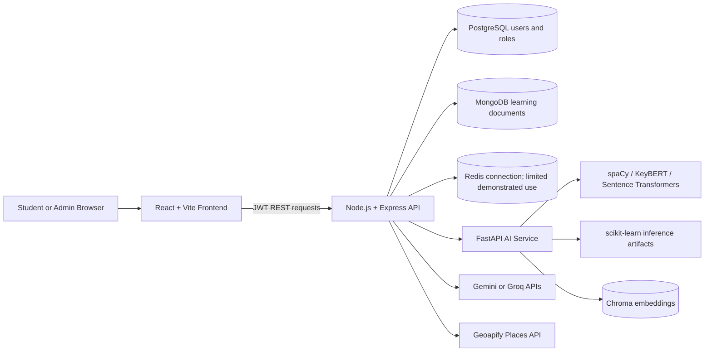
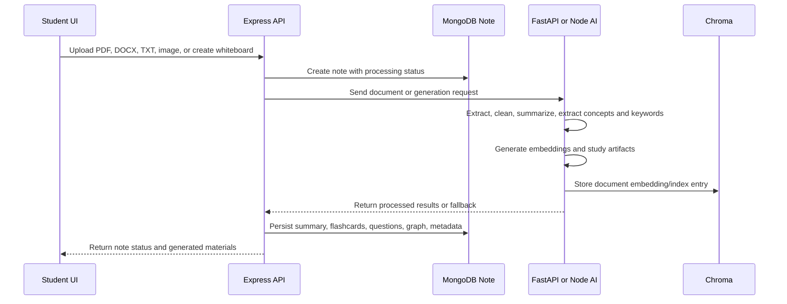
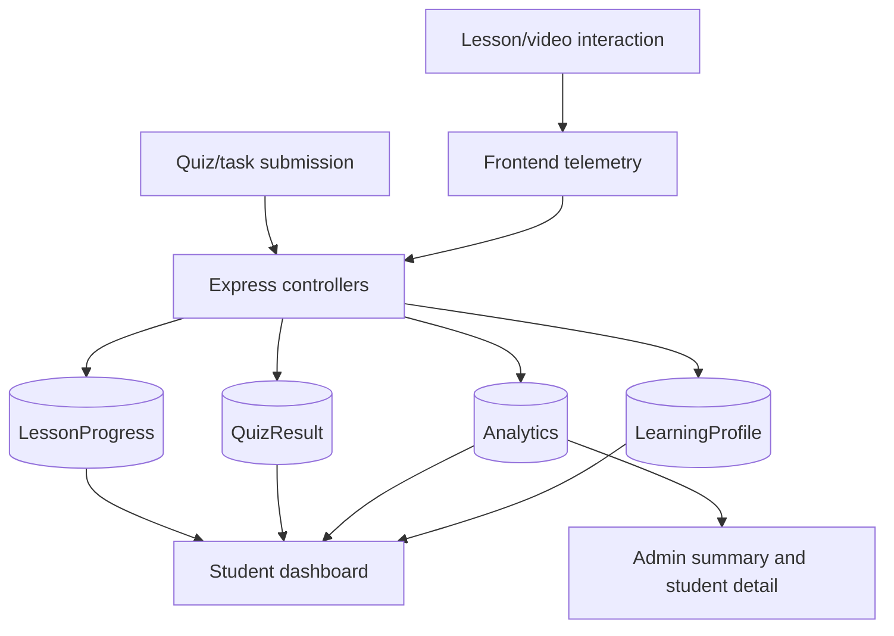
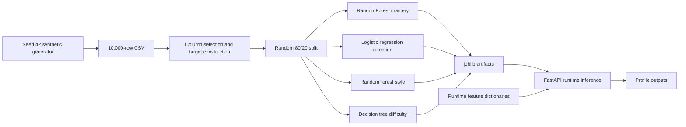

# Deliverable 5 - Architecture and Methodology

## System architecture

**Figure 1.** Source-grounded deployment and runtime architecture. Redis is shown as a configured dependency, not as verified session/cache behavior.

## Feature workflow: Smart Notes

**Figure 2.** Document-to-study-material workflow. External LLM calls are optional and can be replaced by local heuristics/templates.

## Activity and analytics data flow

**Figure 3.** Verified persistence flow for learning and programming activity. The repository does not demonstrate that video behavior is converted into comprehension.

## Model pipeline

**Figure 4.** Training and inference pipeline. Artifact-backed inference follows the training feature order; the emergency in-memory retention and style models use different feature meanings and are not schema-compatible.

## Methodology reconstructed from source

1. **Identity and access:** PostgreSQL stores users and roles. Express signs JWTs after bcrypt verification. Middleware protects most application routes and an admin middleware checks the role.
2. **Content and learning state:** MongoDB models store notes, lessons, progress, results, profiles, recommendations, academy events, and administration data.
3. **AI processing:** Node clients call Gemini/Groq where configured. The Python service uses NLP, embedding, graph, and scikit-learn pipelines. Local fallbacks make some requests return without external services.
4. **Telemetry:** Programming lesson playback events are collected by the frontend and saved to a unique `(userId, lessonId)` progress document. Fields include segments, pauses, replays, percentage, speed, duration, time, and completion.
5. **Dashboard aggregation:** Frontend pages request backend summaries and display progress, analytics, recommendations, generated materials, and administrative records.
6. **Deployment:** Docker Compose provisions MongoDB, PostgreSQL, Redis, Chroma, backend, and AI service. Render configuration provisions only the backend and expects external AI service configuration.

## Reproducibility requirements

A repeatable evaluation should pin dependency lockfiles, record the Python model package versions, validate `feature_names_in_` against runtime schemas, seed all random processes, keep a held-out evaluation set, and capture generated model metrics in versioned reports. It should also use test fixtures for MongoDB/PostgreSQL and verify API authorization and dashboard formulas end to end.
