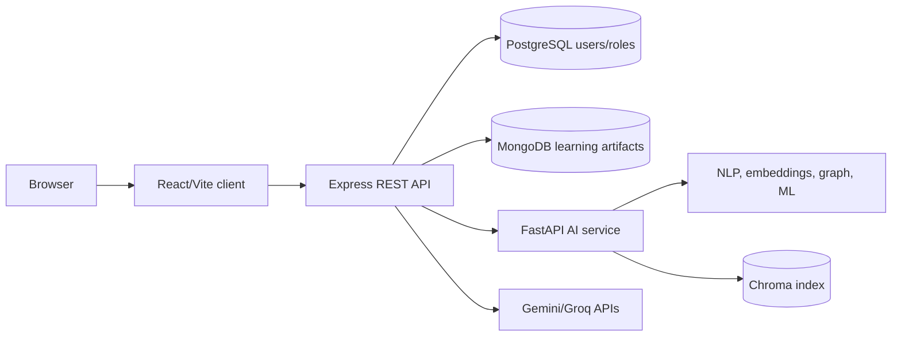
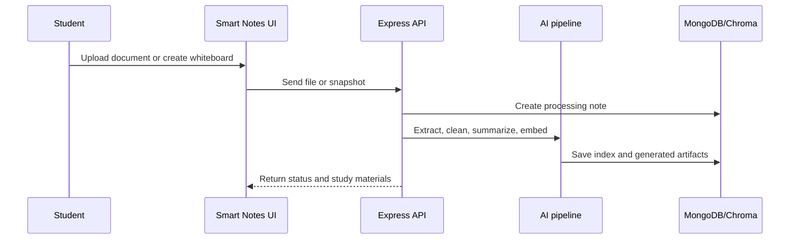
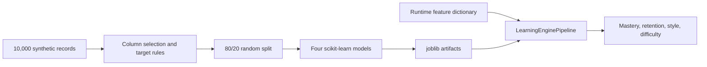
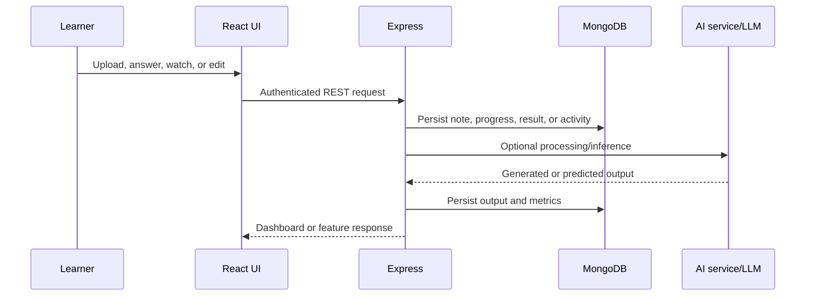

# FirstStep Digital Edu Platform: An Evidence-Based Modular Architecture for AI-Assisted Learning and Learning Analytics

## Abstract

This paper presents FirstStep, a modular digital education platform combining structured lessons, document-based study-material generation, learner activity persistence, assessment, dashboards, and selected machine-learning and generative-AI components. The system was analyzed from its implementation rather than from its intended feature description. Its verified stack comprises a React/Vite client, an Express API, PostgreSQL authentication, MongoDB learning artifacts, and a FastAPI AI service. Smart Notes combines PDF/DOCX/text processing, NLP, embeddings, Chroma indexing, external generative APIs, and local fallbacks. Programming lessons record video playback telemetry, while learning and administrative dashboards expose progress and engagement data. Four scikit-learn models are trained on 10,000 synthetic records. The corrected run produced mastery $R^2=0.5809$ and MAE $=2.0017$, retention accuracy $=94.10\%$, learning-style accuracy $=86.89\%$, and difficulty accuracy $=91.35\%$, with balanced accuracies of $93.74\%$, $87.79\%$, and $91.43\%$ for the three classifiers. These scores are not evidence of real-world educational validity: the data and style/difficulty targets are synthetic. The principal contribution is therefore a source-grounded integration architecture and an explicit audit of its evidence boundary, rather than a claim of novel learning algorithms or improved learning outcomes.

**Keywords:** artificial intelligence in education, learning analytics, personalized learning, educational technology, document processing, learner modeling, video telemetry, scikit-learn

> **Use of this document.** The material below expands the IEEE-style paper into approximately 45-55 pages when formatted with a title page, table of contents, figures, tables, screenshots, 1.15-1.5 line spacing, and appendices. Statements marked as verified are grounded in the repository audit. Statements marked as proposed, recommended, or not verified must not be presented as completed functionality without a corresponding implementation or experiment.

## I. Introduction

Digital learning systems commonly provide content and record activity, but personalization requires a learner representation, appropriate adaptation, feedback, and evidence that the adaptation supports learning. Adaptive hypermedia research established the importance of user models for adaptation [1], while intelligent tutoring research shows that automated assistance must be evaluated as an instructional interaction rather than assumed effective because it is intelligent [2], [3].

FirstStep was designed for modular digital learning, including learners who may have limited educational resources or connectivity. Its implementation joins educational content, document-derived materials, assessments, activity analytics, visual structures, and administration. This paper asks a narrower engineering question: what has actually been implemented, what AI/ML methods are present, and what can be claimed from the available evidence?

## II. Problem Statement and Objectives

The motivating problem is that content delivery alone does not represent individual progress, learning behavior, weak concepts, or the need for revision. The implementation objective is to provide a single platform where a learner can access lessons, generate study materials from documents, receive assessment and recommendation support, and review progress while administrators can inspect student activity.

The audit objectives were to:

1. Reconstruct the deployed architecture and data flows.
2. Classify features as verified, partial, prototype, planned, or unverifiable.
3. identify every independently trained model and distinguish it from pretrained models, LLM APIs, heuristics, and application logic.
4. Reproduce available ML metrics without inventing users, outcomes, or performance improvements.

## III. Related Work

Adaptive hypermedia provides the conceptual basis for adapting presentation and navigation to user models [1]. Intelligent tutoring systems have been compared with human tutoring and other tutoring formats, showing why instructional interaction and evaluation matter [2]. Roll and Wylie describe the movement from early rule-based systems toward broader data-driven AI in education [3]. A systematic review by Zawacki-Richter et al. identifies profiling/prediction, assessment, adaptive personalization, and intelligent tutoring as major AI-in-education application areas [4]. Concept-map-based student understanding analysis is a relevant precedent for visual concept structures [5]. Meta-analytic work on tutoring systems further motivates outcome-based evaluation rather than treating usage as learning [6].

FirstStep relates to this literature through integration: it implements learner profiles, assessment, recommendations, graph structures, and generated explanations in one application. It does not establish a new adaptive algorithm, and its current repository evidence does not support claims of learning gains or superiority over existing platforms.

## IV. System Architecture

The source-grounded architecture is shown in Fig. 1. The frontend uses React, Vite, React Router, Tailwind, Chart.js, React Flow, Mermaid, tldraw, and Framer Motion. Express exposes REST routes under `/api` and `/api/v1`. PostgreSQL is the active identity store and MongoDB stores educational/application documents. FastAPI exposes AI routes. Redis is configured, but substantial session or cache behavior was not verified.

**Fig. 1.** FirstStep runtime architecture reconstructed from source.

## V. Feature Methodology

### A. Smart Notes

The Smart Notes workflow creates a MongoDB note, processes PDF/DOCX/text/image inputs where dependencies permit, cleans text, extracts keywords and concepts, creates embeddings, stores an index entry, and persists generated materials. The Node layer uses Gemini or Groq when configured and local fallbacks otherwise. Stored outputs include summaries, keywords, concepts, relationships, difficulty, study time, flashcards, questions, glossary data, revision sheets, mind maps, and whiteboard snapshots.

The Python document pipeline uses spaCy NER, KeyBERT, Sentence Transformers `all-MiniLM-L6-v2`, Chroma, dependency parsing, and an extractive first/last-sentence summary. It is not a retrieval-augmented question-answering system in the strict sense: the repository shows indexing and semantic search, but does not establish a complete grounded generation loop with retrieval evidence for every answer.

**Fig. 2.** Smart Notes document-to-study-material workflow.

### B. Learning, Assessment, and Twin

Lesson and quiz routes update profiles, analytics, weak concepts, and activity records. The Learning Twin stores style, attention, knowledge score, sessions, mistakes, strengths, and weaknesses. However, the Python Twin starts some attributes randomly and retains state in process memory. The verified implementation is therefore a mixed learner profile rather than a validated digital twin.

### C. Knowledge Forest and Thinking Lab

Knowledge Forest stores nodes, edges, gaps, and path structures and uses NetworkX. The current Python generator uses a fixed synthetic hierarchy and random mastery values. Thinking Lab provides challenge and location flows, scoring, histories, and fallback evaluation. These are functional application modules, but their AI behavior is partly rule-based, fallback-driven, or synthetic.

### D. Video telemetry and dashboards

Programming lesson playback is represented by percentage, pauses, replays, speed, time, watched segments, duration, completion, and timestamps. Student and admin dashboards aggregate persisted learning data. These measurements describe interaction with media; they do not establish attention, comprehension, or retention.

## VI. AI and ML Implementation

Four models are trained by `ai_service/training/train_model.py` on a synthetic dataset generated with seed 42. Mastery uses an `ExtraTreesRegressor`, retention uses logistic regression, learning style uses a random-forest classifier, and difficulty uses a random-forest classifier. Mastery and style use grouped holdouts by synthetic persona; retention and difficulty use stratified 80/20 holdouts.

| Model                  | Target                              | Test result                                       |
| ---------------------- | ----------------------------------- | ------------------------------------------------- |
| ExtraTreesRegressor    | overall mastery scaled to 0-100     | $R^2=0.5809$, MAE $=2.0017$                       |
| LogisticRegression     | retention score thresholded at 0.65 | Accuracy $=94.10\%$, balanced accuracy $=93.74\%$ |
| RandomForestClassifier | four preferred learning modes       | Accuracy $=86.89\%$, balanced accuracy $=87.79\%$ |
| RandomForestClassifier | synthetic persona-based difficulty  | Accuracy $=91.35\%$, balanced accuracy $=91.43\%$ |

These are synthetic-data checks, not real-student validation. The style target is generated from the telemetry features used by the classifier, and the difficulty target is generated from student persona, so both require real observed outcomes before they can support educational claims.

**Fig. 3.** Training and inference pipeline with the documented evidence boundary.

## VII. Data Flow and Persistence

**Fig. 4.** Generic feature data flow.

For programming lessons, watched segments and counters are persisted in a unique user/lesson progress document. For notes, generated artifacts are embedded in a MongoDB note document. Authentication records and passwords are separated into PostgreSQL. This separation is workable but increases consistency and authorization responsibilities across stores.

## VIII. Experimental Evaluation

### A. Measured checks

The frontend production build passed locally on 2026-10-11. The repository contains backend Node test files and AI-service Python contract tests; the exact pass counts and execution date must be refreshed immediately before submission. The ML training pipeline completed and printed the table in Section VI. Older audit notes that describe the backend as a placeholder and the AI suite as empty should be treated as superseded historical observations, not current test results.

### B. What was not measured

No real student participants, learning gains, usability survey, accessibility audit, offline experiment, response-time benchmark, content-accuracy review, or telemetry ground-truth comparison was available. The project therefore cannot claim improved retention, engagement, academic achievement, or rural access outcomes.

### C. Recommended evaluation protocol

Future work should use a versioned real or consented dataset, student-level train/test separation, cross-validation, calibration, macro-F1 and confusion matrices for classifiers, MAE/RMSE for mastery, feature-schema validation, and subgroup error analysis. Smart Notes should be evaluated by subject experts for factuality, relevance, coverage, and citation/grounding. Video telemetry should be compared with event logs and comprehension checks. A controlled or quasi-experimental study should compare learning gains against a content-only baseline.

## IX. Security, Privacy, Ethics, and Bias

The backend hashes passwords with bcrypt and signs JWTs, and admin routes check the database role. However, the frontend stores tokens in `localStorage`; FastAPI has permissive CORS and no authentication middleware; some endpoints accept caller-supplied identifiers; and external LLMs may receive educational content. A deployment file contains a real-looking database credential and must be rotated. Student activity, inferred profiles, and generated assessments require purpose limitation, retention rules, consent, access logs, and deletion controls.

Synthetic personas and labels may encode designer assumptions. The style classifier result indicates weak validity, and learning-style labels should not be used as fixed psychological categories. Playback should not be treated as comprehension. Recommendations should remain assistive and reviewable, especially for students who may be disadvantaged by biased or incomplete telemetry.

## X. Limitations and Threats to Validity

This is a repository audit and engineering evaluation, not a clinical, educational, or user study. The AI service has process-local state in several modules. External service availability and keys were not available for end-to-end verification. Docker dependency/configuration gaps may force fallback paths. The synthetic dataset, random split, threshold-created labels, missing tests, and schema-incompatible emergency retention/style fallbacks threaten external validity and reproducibility. The paper intentionally classifies offline learning as unimplemented.

## XI. Future Enhancements

1. Define a shared, versioned feature schema and retrain models using real, consented telemetry.
2. Add cross-validation, calibration, subgroup fairness, drift monitoring, and model cards.
3. Replace process-local AI state with authenticated persistent storage and idempotent event processing.
4. Secure FastAPI routes, restrict CORS, remove credentials from deployment files, and move browser tokens to a safer session design.
5. Add service-worker caching, IndexedDB content packages, offline queues, and synchronization conflict handling if offline learning remains a goal.
6. Add automated API, authorization, persistence, dashboard, and AI contract tests.
7. Evaluate generated educational content with subject-matter experts and retrieval-grounded citations.
8. Measure learning outcomes with an appropriate comparison group rather than inferring learning from usage.

## XII. Conclusion

FirstStep is a substantial educational software prototype with verified modular architecture, document processing, activity persistence, dashboards, programming telemetry, and four reproducible synthetic-data ML training paths. Its strongest research value is the integration of these components and the explicit representation of evidence boundaries. The current repository does not justify claims of a validated adaptive learning system, offline capability, real-world learner improvement, or novel algorithmic performance. Those claims require feature-contract repair, security hardening, persistent AI state, automated testing, real data, and educational evaluation.

## XIII. Expanded Project Documentation

The following chapters are report-ready material for a university project document. They provide the depth requested in the proposed contents list while preserving the distinction between implemented behavior and future work.

### 13.1 Project background

Access to educational content is not equivalent to access to effective learning. A learner may have a lesson but lack a way to organize notes, identify prerequisite concepts, practise retrieval, interpret mistakes, or decide what to study next. These problems become more visible when learners use a mixture of videos, documents, quizzes, informal notes, and external applications. The information is distributed, progress is difficult to observe, and the learner often receives no coherent explanation of weak areas.

FirstStep addresses this coordination problem through a single web platform. Its design combines a structured Learning Academy, programming lessons, Smart Notes, assessments, a Learning Twin, a Knowledge Forest, and a Thinking Lab. The system is therefore best described as an integrated educational software platform with AI-assisted components. It is not yet a scientifically validated tutor and should not be described as one in the final claims.

The project has four practical motivations:

1. **Organization:** provide one place for lessons, notes, assessments, and progress.
2. **Personal support:** use observed activity to suggest revision and practice actions.
3. **Content transformation:** convert learner-provided documents into searchable study materials.
4. **Evidence-aware engineering:** expose the difference between implemented software, model experiments, and educational evidence.

### 13.2 Need for the system

Traditional content management systems generally optimize for publishing and access. They may record completion, but completion alone does not reveal whether the learner understood the material. Stand-alone note-taking tools do not normally connect a note to a lesson, quiz, weak concept, or revision schedule. Generic AI assistants can produce explanations but may not preserve learner ownership, course context, or assessment history. FirstStep is intended to connect these activities through shared identity, persistence, analytics, and recommendation surfaces.

The need is especially relevant for learners who use low-cost devices, heterogeneous connectivity, and a mixture of local and online resources. However, the current repository does not prove that the system works offline or that it improves rural access. Those are design motivations and future evaluation questions, not measured outcomes.

### 13.3 Scope and contributions

The implemented scope includes account creation and authentication, role-aware administration, structured lessons and quizzes, programming learning, document and note workflows, analytics, recommendation responses, AI-service integration, model training, and visual learning interfaces. The project does not establish a validated psychological learning-style detector, a fully persistent digital twin, a complete retrieval-grounded question-answering evaluation, a guaranteed offline mode, or a controlled study of learning gains.

The defensible contributions are: a modular full-stack educational architecture; a Smart Notes pipeline combining extraction, NLP, embeddings, vector indexing, and study artifacts; a reproducible synthetic-data ML baseline; and a source-grounded audit method that checks feature claims against routes, persistence models, tests, and runtime constraints.

## XIV. Literature Survey and Comparative Analysis

### 14.1 Existing systems

Existing educational platforms can be grouped into learning management systems, intelligent tutoring systems, adaptive hypermedia, digital note applications, coding practice platforms, and conversational AI tools. Learning management systems are strong at enrollment, content delivery, grading, and reporting. Intelligent tutoring systems focus on step-level assistance and domain models. Adaptive hypermedia changes navigation or presentation based on a user model. Note applications emphasize capture and retrieval. Coding platforms provide executable practice and feedback. Conversational systems provide flexible explanations but require careful grounding and privacy controls.

FirstStep overlaps with each category but is not a direct replacement for all of them. Its distinctive engineering choice is integration: a learner can move from a lesson to a quiz, from a document to generated flashcards, from activity records to a dashboard, and from weak topics to recommended actions. The integration itself creates additional consistency, authorization, privacy, and data-quality responsibilities.

### 14.2 Limitations and gaps

The limitations motivating FirstStep are fragmentation, weak connection between activity and revision, limited support for learner-provided documents, and the difficulty of interpreting progress across different learning modes. A platform may show that a video was watched without showing whether the learner could apply the concept. A note application may index text without linking it to assessment evidence. A dashboard may display percentages without explaining their source or uncertainty.

The implementation and literature review identify these gaps: no shared versioned feature schema across Node and Python; limited evidence for generated-material accuracy; synthetic rather than observed labels for style and difficulty; incomplete persistence for process-local AI state; no calibration, subgroup analysis, drift monitoring, or external validation; no verified offline synchronization protocol; and incomplete end-to-end testing across databases, external providers, and browsers.

### 14.3 Problem statement and objectives

The problem addressed is the design and implementation of an integrated digital learning platform that can organize content, transform learner documents into study aids, record activity, and provide assistive analytics while maintaining clear boundaries around privacy, security, and evidence. The challenge is not simply to add an AI call. It is to preserve a reliable relationship between an interaction, the data stored for that interaction, the model or rule that processes it, and the educational interpretation shown to a learner.

The objectives are to design a responsive client; implement authenticated REST services; persist identity separately from learning artifacts; support lessons, quizzes, programming, notes, assessments, and dashboards; process supported documents; store embeddings; train baseline models; test request contracts and ownership boundaries; and document a credible path toward real-world evaluation.

## XV. Proposed System and Requirements

### 15.1 High-level operation

The user accesses the React client through a browser. The client authenticates through Express and receives a token-based session. The API validates requests, applies ownership and role checks, and reads or writes PostgreSQL and MongoDB. AI-assisted operations are delegated to Node-side providers or FastAPI. The response is returned in a consistent API envelope and rendered by the relevant page or dashboard.

PostgreSQL is used for identity and role data, where relational constraints are useful. MongoDB stores changing educational documents and activity artifacts. The Python service isolates NLP and model dependencies from the JavaScript application. This separation also creates distributed failure modes: one service may be available while another is unavailable, and a successful response must not be confused with durable persistence.

### 15.2 Client, software, and hardware requirements

The client requires a modern browser with JavaScript enabled, network access to the configured API, a supported session mechanism, and sufficient memory for charts, diagrams, document previews, and editors. The administrator client requires a role authorized by the backend; a frontend-only role check is not sufficient.

The verified development stack includes Node.js and npm, Python, MongoDB, PostgreSQL, and optionally Redis and Chroma. Docker Compose can provision the local service set where Docker is available. The frontend uses React and Vite with Tailwind and visualization libraries. The backend uses Express, validation schemas, JWT, bcrypt, Mongoose, and PostgreSQL access. The AI service uses FastAPI, spaCy, KeyBERT, Sentence Transformers, NetworkX, scikit-learn, document parsers, and optional providers.

For development, a dual-core processor, 8 GB RAM, 10 GB free storage, and stable network are a practical minimum. A machine running local embeddings, OCR, Chroma, MongoDB, PostgreSQL, and several processes benefits from 16 GB RAM. Production hardware must be sized using measured concurrency, document size, model memory, database growth, and retention policy.

### 15.3 Functional requirements

| ID    | Requirement                                                                  | Acceptance evidence                           |
| :---- | :--------------------------------------------------------------------------- | :-------------------------------------------- |
| FR-01 | A user can register and authenticate.                                        | Auth validation and repository tests.         |
| FR-02 | The system enforces ownership of learner records.                            | Route and IDOR regression tests.              |
| FR-03 | An administrator can manage authorized curriculum resources.                 | Admin contract and authorization tests.       |
| FR-04 | A learner can access published lessons and assessments.                      | Learning route and publication tests.         |
| FR-05 | A learner can record programming progress and notes.                         | Programming contract and persistence tests.   |
| FR-06 | A learner can submit supported note content.                                 | Upload validation and fallback tests.         |
| FR-07 | The system can produce structured study artifacts where dependencies permit. | AI contract and provider/fallback checks.     |
| FR-08 | Dashboards display persisted activity without inventing scores.              | Analytics and empty-state tests.              |
| FR-09 | AI-service requests require the shared service key.                          | AI authentication tests.                      |
| FR-10 | Model inference uses a compatible feature contract.                          | Model contract tests and artifact inspection. |

### 15.4 Non-functional requirements

The platform should provide confidentiality, integrity, availability, usability, maintainability, portability, observability, and reproducibility. Confidentiality requires authentication, authorization, secret management, and careful external-provider handling. Integrity requires validation, ownership filters, bounded payloads, and compensation for multi-step writes. Availability requires explicit fallback and failure states. Maintainability requires modular services, tests, and documented schemas. Reproducibility requires pinned dependencies, fixed seeds, versioned data, and recorded commands.

## XVI. Design and Module Organization

### 16.1 Component organization

The frontend is organized around pages, layouts, contexts, services, router configuration, theme utilities, and reusable UI components. The backend separates routes, controllers, services, repositories, models, middleware, and configuration. The AI service separates routers, pipelines, model loading, document utilities, and training assets. This organization keeps transport concerns separate from business rules and storage concerns.

### 16.2 Authentication and authorization

Registration validates and canonicalizes account inputs before password hashing. Login verifies the password and issues a signed token. Middleware extracts and verifies the token before protected controllers execute. Admin middleware checks the persisted role rather than trusting a client field. Resource operations filter by the authenticated user or an authorized relationship.

The security model must account for vertical access, such as learner versus administrator, and horizontal access, such as one learner reading another learner's notes. Every controller that receives an ID should resolve the ID through the authenticated owner. Validation is necessary but not sufficient: a valid identifier can still refer to the wrong user's document.

### 16.3 Data design

PostgreSQL stores user identity and role information. MongoDB stores flexible learning documents, including lessons, quizzes, tasks, notes, progress, analytics, recommendations, profiles, and module-specific records. The design supports feature iteration but requires explicit indexes, bounded arrays, stable enums, and data-retention rules. Account deletion requires coordinated deletion or anonymization across both stores and any vector index.

### 16.4 Smart Notes

Smart Notes follows a staged pipeline: input acceptance, metadata validation, file persistence, extraction, cleaning, language processing, summarization, keyword and concept extraction, embedding, optional vector indexing, generation of study artifacts, and status persistence. Each stage should be observable and idempotent. A failure should produce a failed note with a safe message, not a processed note containing fabricated text.

Supported artifacts may include a summary, keywords, concepts, relationships, glossary entries, flashcards, questions, revision sheets, mind-map data, and whiteboard snapshots. Generated text must be treated as assistive output. A future release should preserve source spans or retrieval references so that learners can inspect why a generated statement was produced.

### 16.5 Learning Academy and assessment

The Academy organizes learning into lessons, stages, activities, practice sessions, reviews, and recommendations. Completion events should record the actual operation and timestamp. Scores should be recorded only when an assessment produces them. A practice completion event must not be transformed into a guessed quiz score or retention percentage. Recommendation endpoints should return links to published content and explain which observed evidence influenced the recommendation.

### 16.6 Programming Learning and telemetry

Programming Learning provides lessons, video playback, quizzes, notes, and progress. Telemetry includes watched segments, percentage, pauses, replays, speed, time spent, duration, and completion. These fields enable descriptive dashboards and future analysis. They do not prove attention or comprehension. Quiz scoring should distinguish objectively graded responses from free-form responses requiring rubric or human review.

### 16.7 Learning Twin, Knowledge Forest, and Thinking Lab

The Learning Twin is a learner-profile abstraction rather than a validated digital replica. It can aggregate assessment, lesson, video, Academy, Thinking Lab, notes, revision, and sprint evidence. Recommendations should be generated from observed records and link to published lessons. Empty or unavailable data must be represented explicitly rather than replaced with default percentages.

Knowledge Forest represents topics and relationships as nodes and edges. NetworkX supports graph operations, while the current generator includes synthetic hierarchy behavior. Thinking Lab stores challenges, answers, scores, histories, career interests, and location-related flows. Their recommendation and scoring logic requires real-user evaluation before it can be interpreted as cognitive measurement.

### 16.8 UML and data-flow material

For the final report, add a use-case diagram with Student, Administrator, External AI Provider, and System Operator. Student use cases include authentication, lesson browsing, assessment, note upload, dashboard review, programming practice, and recommendations. Administrator use cases include curriculum management, activity inspection, and notification management. External providers are secondary actors and should never be treated as trusted storage.

Add figures for deployment, Smart Notes sequence, authentication, assessment, programming telemetry, ML pipeline, and entity relationships. Each figure should have a caption, source, and paragraph explaining its design decision.

## XVII. Implementation and Procedures

### 17.1 Development procedure

Development proceeds by tracing a feature from page action to client service, route, validator, controller, repository, model, and response. The expected contract is recorded at each boundary. A feature is complete only when request shape, response shape, persistence, authorization, error state, and test evidence agree.

This procedure was important for Academy, Assessment, Programming Learning, Smart Notes, Twin, Thinking Lab, and Admin. Several defects were contract defects rather than algorithm defects: the client and validator disagreed on payload shape, a route trusted a caller-provided identity, or a fallback wrote a synthetic score. Contract-first tracing prevents a visually successful page from hiding these failures.

### 17.2 Document-processing procedure

Processing begins with a bounded upload. The server creates a processing record and stores the original only after validating the request. Extraction is selected according to media type. Plain text and Markdown can use a local text path. PDF, DOCX, and image processing require their parsers and system dependencies. Unsupported binary data must result in a clear failure rather than a UTF-8 guess.

After extraction, text is normalized and passed through NLP components. Named entities and keywords support organization, embeddings support similarity, and summarization creates a compact representation. Generated materials are persisted with their source note, status, timestamps, and model/provider metadata. A future implementation should add a processing job identifier, retry count, and content hash for idempotency.

### 17.3 Model-training procedure

The synthetic data generator creates 10,000 rows with a fixed seed. Feature selection and target construction occur in the training script. The mastery target is continuous and evaluated with regression metrics. Retention, learning mode, and difficulty are classification targets evaluated with accuracy and balanced accuracy. Model artifacts are stored with their expected feature order.

These are baseline engineering metrics. They do not demonstrate that the system identifies a student's true learning style or predicts actual retention. A production procedure requires consented data, a label protocol, student-level splits, cross-validation, calibration, subgroup analysis, leakage checks, and a test set that is never used for tuning.

### 17.4 Deployment procedure

Local deployment requires environment variables for database URLs, JWT signing, AI-service authentication, allowed origins, and optional provider keys. Docker Compose can coordinate services when Docker is installed. Secrets must be supplied through the environment or a secret manager and must not be committed to deployment files. The AI service should remain on an internal network unless an authenticated public interface is required.

Before a release, run dependency installation, syntax checks, backend tests, AI contract tests, frontend production build, configuration validation, database initialization checks, and an authenticated smoke test. Record versions, timestamps, commands, and unavailable dependencies in the release report.

## XVIII. Testing and Validation

### 18.1 Test strategy

Testing is organized into unit, contract, integration, security, build, and evaluation checks. Unit tests isolate scoring, normalization, fallback, and recommendation rules. Contract tests verify frontend-shaped payloads and response envelopes. Integration tests connect routes to repositories and databases. Security tests exercise missing authentication, wrong ownership, invalid IDs, role boundaries, and oversized inputs. Build checks verify that the frontend bundles and service source is syntactically valid.

### 18.2 Test case catalogue

| ID    | Scenario                                          | Expected result                                         |
| :---- | :------------------------------------------------ | :------------------------------------------------------ |
| TC-01 | Register with a valid account.                    | Account is normalized, hashed, and created.             |
| TC-02 | Register with a short or oversized password.      | Validation returns a client error.                      |
| TC-03 | Read another user's note by ID.                   | Request is rejected or returns not found.               |
| TC-04 | Submit assessment with the page's response shape. | Request is accepted and measured results persist.       |
| TC-05 | Submit duplicate or invalid options.              | Request is rejected.                                    |
| TC-06 | Upload readable text.                             | Note enters processing and stores extracted content.    |
| TC-07 | Upload binary data labelled as text.              | Processing fails safely; fabricated text is not stored. |
| TC-08 | Submit an unknown offline lesson ID.              | Service returns not found.                              |
| TC-09 | Save programming notes for a published lesson.    | Note is upserted for the authenticated owner.           |
| TC-10 | Mark an unpublished lesson complete.              | Operation is rejected.                                  |
| TC-11 | Call an AI route without the service key.         | Request fails closed.                                   |
| TC-12 | Request an empty Twin profile.                    | Empty state is explicit; invented scores are absent.    |
| TC-13 | Run curriculum seed twice.                        | Existing records are preserved.                         |
| TC-14 | Send an oversized JSON body.                      | Parser returns 413 before expensive processing.         |
| TC-15 | Build the frontend for production.                | Vite completes without build errors.                    |

### 18.3 Validation criteria

Validation should answer five questions: does the request match the contract; is the caller allowed; is the result persisted under the correct owner; does the UI display the actual response and error state; and can the behavior be reproduced in a clean environment? A feature that passes only the first question is not complete.

### 18.4 Performance and usability validation

The final report should add measured latency percentiles for authentication, lesson retrieval, note upload, note processing, assessment submission, and dashboard loading. Measurements must specify hardware, dataset size, provider configuration, concurrency, and cache state. Also record upload limits, memory behavior, database indexes, and failure recovery time. Do not invent benchmark values from static inspection.

Accessibility validation should include keyboard navigation, focus visibility, semantic headings, form labels, contrast, error announcements, reduced-motion behavior, responsive layouts, and screen-reader checks. Usability tasks should include sign-up, lesson discovery, note upload, flashcard review, quiz completion, weak-area inspection, and programming-note saving. The current repository does not contain a completed user study.

## XIX. Results and Result Analysis

### 19.1 Implemented outputs

Implemented outputs include authenticated pages, structured lesson views, assessment forms, programming lesson and progress views, Smart Notes records and generated-material fields, dashboards, graph-oriented views, Thinking Lab interactions, and administrative tables. Capture current-build screenshots and insert them as numbered figures. Each screenshot should state the user action and data source.

Recommended screens are: login and registration validation; learner dashboard empty state; Academy lesson; assessment result; programming video and quiz; Smart Notes upload and processing; generated flashcards and revision sheet; Knowledge Forest graph; Learning Twin evidence and recommendations; Thinking Lab challenge; administrator curriculum page; and test evidence summary.

### 19.2 ML result analysis

The mastery result of $R^2=0.5809$ and MAE $=2.0017$ indicates moderate fit to the generated continuous target under the documented split. Retention, learning mode, and difficulty produce high accuracy on generated labels. Because the labels are created by rules or synthetic personas, the result mainly demonstrates that the training pipeline runs and reproduces patterns in generated data. It does not demonstrate generalization to real learners.

The final report should include confusion matrices, class distributions, baseline comparisons, feature importance or coefficients, calibration plots, and error examples. It should state whether the test set was isolated before model selection and whether repeated seeded runs reproduce the metrics. If these artifacts are not generated, say so rather than insert illustrative values.

### 19.3 Overall interpretation

The strongest verified result is architectural and procedural: the project provides a connected platform and a testable path from activity to stored evidence and assistive output. The weakest evidence area is educational effectiveness. Usage, completion, watch percentage, generated content, and model scores are intermediate signals. They are useful for engineering observability, but they are not substitutes for comprehension tests, delayed retention tests, learning gains, or validated usability measures.

## XX. Security, Privacy, Ethics, and Responsible AI

Educational data can reveal identity, interests, performance, mistakes, schedules, inferred weaknesses, and sensitive documents. The system should collect only what is needed, explain why it is collected, restrict access, encrypt transport, protect secrets, define retention periods, and support correction and deletion. External model providers require a documented data-processing decision and should receive the minimum necessary content.

The project must avoid presenting inferred learning style as a fixed psychological truth. Recommendations should be assistive, contestable, and reversible. A low model score should not deny access to content or label a learner as incapable. Human review is appropriate for ambiguous generated feedback and content that may affect assessment.

Threat modeling should cover authentication, authorization, file uploads, prompt injection, model output handling, denial of service, database access, secret leakage, and cross-tenant exposure. The existing audit identifies important controls and remaining verification gaps. The final report should list the deployment configuration used for submission and remove or rotate credential-like values.

## XXI. Limitations and Threats to Validity

The implementation is a prototype evaluated primarily through source inspection, focused tests, builds, and synthetic model experiments. It is not a randomized educational intervention. The dataset does not represent a population of students. Generated labels may encode the same assumptions used by the features, creating leakage or optimistic metrics. Runtime behavior involving external providers, Docker, browser journeys, OCR, and live databases must be recorded separately.

Internal validity is threatened by fallback paths, process-local state, historical records with uncertain provenance, and differences between artifact-backed inference and emergency in-memory inference. Construct validity is threatened when watch time is interpreted as attention, a generated answer as understanding, or a style category as a psychological trait. External validity is threatened by the absence of real learners, subjects, languages, devices, connectivity conditions, and educational settings.

## XXII. Future Work

Future work should proceed in stages: stabilize contracts, persistence, security, and observability; collect consented and de-identified data; evaluate generated materials with subject experts and learners; compare recommendations against a non-personalized baseline using learning gains and delayed retention; investigate offline synchronization only after defining conflict semantics; and add calibration, fairness, drift, model cards, data deletion, and reproducible deployment automation.

## XXIII. Suggested Appendices for a 50-Page Submission

### Appendix A. Installation and execution record

Include operating system, Node and Python versions, package commands, database setup, environment-variable names without secrets, startup commands, service URLs, and shutdown procedure. Add troubleshooting for missing Docker, unavailable FastAPI dependencies, missing OCR binaries, database failures, and provider-key failures.

### Appendix B. API verification matrix

Include method, path, authentication, role, request schema, response envelope, persistence target, ownership rule, error responses, and test file for each route. Expand the existing API matrix into this submission artifact.

### Appendix C. Data dictionary

Include field name, type, range, source, owner, collection, observed or inferred status, retention period, and model-training use. Mark synthetic fields and generated labels clearly.

### Appendix D. Model cards

For each model include purpose, target, features, training data, split strategy, metrics, intended use, prohibited use, bias, failure modes, version, artifact hash, and retraining trigger. Style and difficulty cards must state that current targets are synthetic.

### Appendix E. Test evidence

Include command output captured on the submission date, pass/fail counts, skipped tests, environment limitations, frontend build output, AI-service contract output, and unexecuted integration checks. Do not copy historical metrics without their execution date.

### Appendix F. Screens and figures

Insert the recommended screenshots plus architecture, sequence, data-flow, UML, and model diagrams. Each image should have a figure number and be referenced from the main text.

### Appendix G. User and administrator manuals

Describe account creation, dashboard navigation, lesson completion, assessment submission, Smart Notes processing, programming learning, recommendation interpretation, content administration, and failure recovery. Explain what a learner can rely on and what remains assistive or experimental.

### Appendix H. Research instruments and consent materials

For future user evaluation, include participant information, consent language, demographic fields, pre-test and post-test design, delayed retention test, usability questionnaire, interview prompts, deletion process, and ethics review status.

## References

[1] P. Brusilovsky, "Adaptive Hypermedia," _User Modeling and User-Adapted Interaction_, vol. 11, no. 1-2, pp. 87-110, 2001, doi: 10.1023/A:1011143116306.

[2] K. VanLehn, "The Relative Effectiveness of Human Tutoring, Intelligent Tutoring Systems, and Other Tutoring Systems," _Educational Psychologist_, vol. 46, no. 4, pp. 197-221, 2011, doi: 10.1080/00461520.2011.611369.

[3] I. Roll and R. Wylie, "Evolution and Revolution in Artificial Intelligence in Education," _International Journal of Artificial Intelligence in Education_, vol. 26, no. 2, pp. 582-599, 2016, doi: 10.1007/s40593-016-0110-3.

[4] O. Zawacki-Richter, V. I. Marín, M. Bond, and F. Gouverneur, "Systematic Review of Research on Artificial Intelligence Applications in Higher Education - Where Are the Educators?," _International Journal of Educational Technology in Higher Education_, vol. 16, no. 1, article 39, 2019, doi: 10.1186/s41239-019-0171-0.

[5] G. P. Jain, V. P. Gurupur, J. L. Schroeder, and E. D. Faulkenberry, "Artificial Intelligence-Based Student Learning Evaluation: A Concept Map-Based Approach for Analyzing a Student's Understanding of a Topic," _IEEE Transactions on Learning Technologies_, vol. 7, no. 3, pp. 267-279, 2014, doi: 10.1109/TLT.2014.2330297.

[6] S. Steenbergen-Hu and H. Cooper, "A Meta-Analysis of the Effectiveness of Intelligent Tutoring Systems on College Students' Academic Learning," _Journal of Educational Psychology_, vol. 106, no. 2, pp. 331-347, 2014, doi: 10.1037/a0034752.
