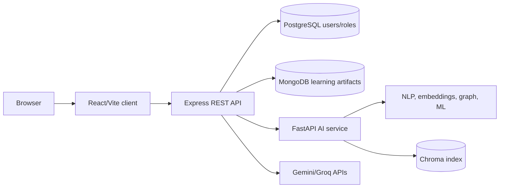
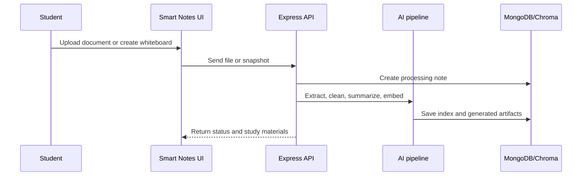
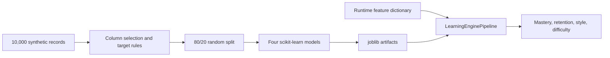
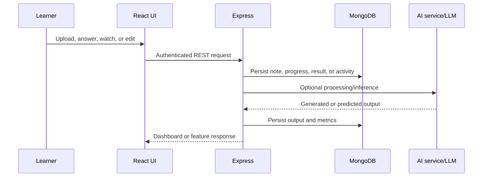

# FirstStep Digital Edu Platform: An Evidence-Based Modular Architecture for AI-Assisted Learning and Learning Analytics

## Abstract

This paper presents FirstStep, a modular digital education platform combining structured lessons, document-based study-material generation, learner activity persistence, assessment, dashboards, and selected machine-learning and generative-AI components. The system was analyzed from its implementation rather than from its intended feature description. Its verified stack comprises a React/Vite client, an Express API, PostgreSQL authentication, MongoDB learning artifacts, and a FastAPI AI service. Smart Notes combines PDF/DOCX/text processing, NLP, embeddings, Chroma indexing, external generative APIs, and local fallbacks. Programming lessons record video playback telemetry, while learning and administrative dashboards expose progress and engagement data. Four scikit-learn models are trained on 10,000 synthetic records. A reproducible run produced mastery $R^2=0.9066$ and MAE $=3.8989$, retention accuracy $=94.10\%$, learning-style accuracy $=25.70\%$, and difficulty accuracy $=100\%$ on an 80/20 split. These scores are not evidence of real-world educational validity: the data are synthetic, the difficulty target is rule-derived, and runtime feature semantics do not fully match training features for retention and style. The principal contribution is therefore a source-grounded integration architecture and an explicit audit of its evidence boundary, rather than a claim of novel learning algorithms or improved learning outcomes.

**Keywords:** artificial intelligence in education, learning analytics, personalized learning, educational technology, document processing, learner modeling, video telemetry, scikit-learn

## I. Introduction

Digital learning systems commonly provide content and record activity, but personalization requires a learner representation, appropriate adaptation, feedback, and evidence that the adaptation supports learning. Adaptive hypermedia research established the importance of user models for adaptation [1], while intelligent tutoring research shows that automated assistance must be evaluated as an instructional interaction rather than assumed effective because it is intelligent [2], [3].

FirstStep was designed for modular digital learning, including learners who may have limited educational resources or connectivity. Its implementation joins educational content, document-derived materials, assessments, activity analytics, visual structures, and administration. This paper asks a narrower engineering question: what has actually been implemented, what AI/ML methods are present, and what can be claimed from the available evidence?

## II. Problem Statement and Objectives

The motivating problem is that content delivery alone does not represent individual progress, learning behavior, weak concepts, or the need for revision. The implementation objective is to provide a single platform where a learner can access lessons, generate study materials from documents, receive assessment and recommendation support, and review progress while administrators can inspect student activity.

The audit objectives were to:

1. Reconstruct the deployed architecture and data flows.
2. Classify features as verified, partial, prototype, planned, or unverifiable.
3. identify every independently trained model and distinguish it from pretrained models, LLM APIs, heuristics, and application logic.
4. Reproduce available ML metrics without inventing users, outcomes, or performance improvements.

## III. Related Work

Adaptive hypermedia provides the conceptual basis for adapting presentation and navigation to user models [1]. Intelligent tutoring systems have been compared with human tutoring and other tutoring formats, showing why instructional interaction and evaluation matter [2]. Roll and Wylie describe the movement from early rule-based systems toward broader data-driven AI in education [3]. A systematic review by Zawacki-Richter et al. identifies profiling/prediction, assessment, adaptive personalization, and intelligent tutoring as major AI-in-education application areas [4]. Concept-map-based student understanding analysis is a relevant precedent for visual concept structures [5]. Meta-analytic work on tutoring systems further motivates outcome-based evaluation rather than treating usage as learning [6].

FirstStep relates to this literature through integration: it implements learner profiles, assessment, recommendations, graph structures, and generated explanations in one application. It does not establish a new adaptive algorithm, and its current repository evidence does not support claims of learning gains or superiority over existing platforms.

## IV. System Architecture

The source-grounded architecture is shown in Fig. 1. The frontend uses React, Vite, React Router, Tailwind, Chart.js, React Flow, Mermaid, tldraw, and Framer Motion. Express exposes REST routes under `/api` and `/api/v1`. PostgreSQL is the active identity store and MongoDB stores educational/application documents. FastAPI exposes AI routes. Redis is configured, but substantial session or cache behavior was not verified.

**Fig. 1.** FirstStep runtime architecture reconstructed from source.

## V. Feature Methodology

### A. Smart Notes

The Smart Notes workflow creates a MongoDB note, processes PDF/DOCX/text/image inputs where dependencies permit, cleans text, extracts keywords and concepts, creates embeddings, stores an index entry, and persists generated materials. The Node layer uses Gemini or Groq when configured and local fallbacks otherwise. Stored outputs include summaries, keywords, concepts, relationships, difficulty, study time, flashcards, questions, glossary data, revision sheets, mind maps, and whiteboard snapshots.

The Python document pipeline uses spaCy NER, KeyBERT, Sentence Transformers `all-MiniLM-L6-v2`, Chroma, dependency parsing, and an extractive first/last-sentence summary. It is not a retrieval-augmented question-answering system in the strict sense: the repository shows indexing and semantic search, but does not establish a complete grounded generation loop with retrieval evidence for every answer.

**Fig. 2.** Smart Notes document-to-study-material workflow.

### B. Learning, Assessment, and Twin

Lesson and quiz routes update profiles, analytics, weak concepts, and activity records. The Learning Twin stores style, attention, knowledge score, sessions, mistakes, strengths, and weaknesses. However, the Python Twin starts some attributes randomly and retains state in process memory. The verified implementation is therefore a mixed learner profile rather than a validated digital twin.

### C. Knowledge Forest and Thinking Lab

Knowledge Forest stores nodes, edges, gaps, and path structures and uses NetworkX. The current Python generator uses a fixed synthetic hierarchy and random mastery values. Thinking Lab provides challenge and location flows, scoring, histories, and fallback evaluation. These are functional application modules, but their AI behavior is partly rule-based, fallback-driven, or synthetic.

### D. Video telemetry and dashboards

Programming lesson playback is represented by percentage, pauses, replays, speed, time, watched segments, duration, completion, and timestamps. Student and admin dashboards aggregate persisted learning data. These measurements describe interaction with media; they do not establish attention, comprehension, or retention.

## VI. AI and ML Implementation

Four models are trained by `ai_service/training/train_model.py` on a synthetic dataset generated with seed 42. Mastery uses a random-forest regressor, retention uses logistic regression, learning style uses a random-forest classifier, and difficulty uses a decision tree. The split is an 80/20 random split with 8,000 training and 2,000 test records.

| Model                  | Target                              | Test result                 |
| ---------------------- | ----------------------------------- | --------------------------- |
| RandomForestRegressor  | overall mastery scaled to 0-100     | $R^2=0.9066$, MAE $=3.8989$ |
| LogisticRegression     | retention score thresholded at 0.65 | Accuracy $=94.10\%$         |
| RandomForestClassifier | four preferred learning modes       | Accuracy $=25.70\%$         |
| DecisionTreeClassifier | rule-derived difficulty class       | Accuracy $=100\%$           |

The style result is close to the four-class chance baseline. The difficulty result is not an independent educational benchmark because its labels are created from threshold logic using related inputs. More importantly, runtime inference sends `daysSinceLastRevision` where training uses `days_active`, and sends reading/drawing/video-ratio/note-length features where training uses video and answer-time features for style. Therefore the training metrics cannot be transferred to production behavior without correcting the feature contract.

**Fig. 3.** Training and inference pipeline with the documented evidence boundary.

## VII. Data Flow and Persistence

**Fig. 4.** Generic feature data flow.

For programming lessons, watched segments and counters are persisted in a unique user/lesson progress document. For notes, generated artifacts are embedded in a MongoDB note document. Authentication records and passwords are separated into PostgreSQL. This separation is workable but increases consistency and authorization responsibilities across stores.

## VIII. Experimental Evaluation

### A. Measured checks

The frontend production build passed locally on 2026-10-11. The backend test command exits successfully but is a placeholder that prints `Error: no test specified`. The AI service test command collected zero tests. The ML training pipeline completed and printed the table in Section VI.

### B. What was not measured

No real student participants, learning gains, usability survey, accessibility audit, offline experiment, response-time benchmark, content-accuracy review, or telemetry ground-truth comparison was available. The project therefore cannot claim improved retention, engagement, academic achievement, or rural access outcomes.

### C. Recommended evaluation protocol

Future work should use a versioned real or consented dataset, student-level train/test separation, cross-validation, calibration, macro-F1 and confusion matrices for classifiers, MAE/RMSE for mastery, feature-schema validation, and subgroup error analysis. Smart Notes should be evaluated by subject experts for factuality, relevance, coverage, and citation/grounding. Video telemetry should be compared with event logs and comprehension checks. A controlled or quasi-experimental study should compare learning gains against a content-only baseline.

## IX. Security, Privacy, Ethics, and Bias

The backend hashes passwords with bcrypt and signs JWTs, and admin routes check the database role. However, the frontend stores tokens in `localStorage`; FastAPI has permissive CORS and no authentication middleware; some endpoints accept caller-supplied identifiers; and external LLMs may receive educational content. A deployment file contains a real-looking database credential and must be rotated. Student activity, inferred profiles, and generated assessments require purpose limitation, retention rules, consent, access logs, and deletion controls.

Synthetic personas and labels may encode designer assumptions. The style classifier result indicates weak validity, and learning-style labels should not be used as fixed psychological categories. Playback should not be treated as comprehension. Recommendations should remain assistive and reviewable, especially for students who may be disadvantaged by biased or incomplete telemetry.

## X. Limitations and Threats to Validity

This is a repository audit and engineering evaluation, not a clinical, educational, or user study. The AI service has process-local state in several modules. External service availability and keys were not available for end-to-end verification. Docker dependency/configuration gaps may force fallback paths. The synthetic dataset, random split, threshold-created labels, missing tests, and runtime feature mismatch threaten external validity and reproducibility. The paper intentionally classifies offline learning as unimplemented.

## XI. Future Enhancements

1. Define a shared, versioned feature schema and retrain models using real, consented telemetry.
2. Add cross-validation, calibration, subgroup fairness, drift monitoring, and model cards.
3. Replace process-local AI state with authenticated persistent storage and idempotent event processing.
4. Secure FastAPI routes, restrict CORS, remove credentials from deployment files, and move browser tokens to a safer session design.
5. Add service-worker caching, IndexedDB content packages, offline queues, and synchronization conflict handling if offline learning remains a goal.
6. Add automated API, authorization, persistence, dashboard, and AI contract tests.
7. Evaluate generated educational content with subject-matter experts and retrieval-grounded citations.
8. Measure learning outcomes with an appropriate comparison group rather than inferring learning from usage.

## XII. Conclusion

FirstStep is a substantial educational software prototype with verified modular architecture, document processing, activity persistence, dashboards, programming telemetry, and four reproducible synthetic-data ML training paths. Its strongest research value is the integration of these components and the explicit representation of evidence boundaries. The current repository does not justify claims of a validated adaptive learning system, offline capability, real-world learner improvement, or novel algorithmic performance. Those claims require feature-contract repair, security hardening, persistent AI state, automated testing, real data, and educational evaluation.

## References

[1] P. Brusilovsky, "Adaptive Hypermedia," _User Modeling and User-Adapted Interaction_, vol. 11, no. 1-2, pp. 87-110, 2001, doi: 10.1023/A:1011143116306.

[2] K. VanLehn, "The Relative Effectiveness of Human Tutoring, Intelligent Tutoring Systems, and Other Tutoring Systems," _Educational Psychologist_, vol. 46, no. 4, pp. 197-221, 2011, doi: 10.1080/00461520.2011.611369.

[3] I. Roll and R. Wylie, "Evolution and Revolution in Artificial Intelligence in Education," _International Journal of Artificial Intelligence in Education_, vol. 26, no. 2, pp. 582-599, 2016, doi: 10.1007/s40593-016-0110-3.

[4] O. Zawacki-Richter, V. I. Marín, M. Bond, and F. Gouverneur, "Systematic Review of Research on Artificial Intelligence Applications in Higher Education - Where Are the Educators?," _International Journal of Educational Technology in Higher Education_, vol. 16, no. 1, article 39, 2019, doi: 10.1186/s41239-019-0171-0.

[5] G. P. Jain, V. P. Gurupur, J. L. Schroeder, and E. D. Faulkenberry, "Artificial Intelligence-Based Student Learning Evaluation: A Concept Map-Based Approach for Analyzing a Student's Understanding of a Topic," _IEEE Transactions on Learning Technologies_, vol. 7, no. 3, pp. 267-279, 2014, doi: 10.1109/TLT.2014.2330297.

[6] S. Steenbergen-Hu and H. Cooper, "A Meta-Analysis of the Effectiveness of Intelligent Tutoring Systems on College Students' Academic Learning," _Journal of Educational Psychology_, vol. 106, no. 2, pp. 331-347, 2014, doi: 10.1037/a0034752.
